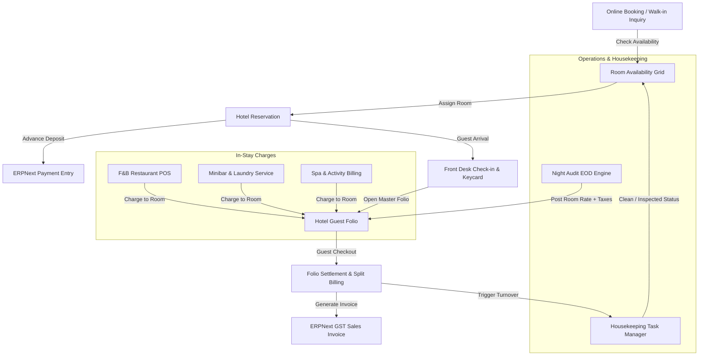

# 🏨 Frappe Hotel PMS — Enterprise Property Management System

[](https://frappeframework.com/)
[](https://erpnext.com/)
[]()
[]()
[](LICENSE)

An enterprise-grade **Hotel Property Management System (PMS)** engineered natively on the Frappe Framework and integrated seamlessly with ERPNext Accounts, POS, and Inventory.

---

## 🎯 The Real-World Client Problem & Hospitality Liabilities

Hotels, luxury resorts, boutique stays, and multi-property chains face severe operational bottlenecks when running on disconnected legacy software:
1. **Room Inventory & OTA Overbooking:** Disconnects between online booking engines (MakeMyTrip, Booking.com, Agoda) and front-desk walk-ins cause double-booking penalties and guest dissatisfaction.
2. **Folio Leakage & Disconnected Point-of-Sale:** F&B restaurants, room service, laundry, spa, and minibar expenses often fail to post accurately to the master guest room folio before express checkout.
3. **Night Audit & Revenue Reconciliation Overhead:** Manual EOD night audit takes hours, causing room revenue discrepancies, tax misallocations, and delayed financial day closure.
4. **Housekeeping & Turnaround Lag:** Front desk staff lack real-time visibility into whether checked-out rooms are dirty, under cleaning, or supervisor-inspected for immediate reassignment.

**How This Engine Solves It:** Delivers a real-time room grid, automated guest folio billing, instant POS-to-room charge posting, housekeeping mobile workflow, and an automated one-click Night Audit settlement engine.

---

## 🏛️ End-to-End Hotel Guest Journey & Architecture



---

## 🚀 Key Engineering Capabilities

- **Interactive Room Rack & Visual Tape Chart:** Real-time visual matrix displaying room status (Occupied, Reserved, Clean, Dirty, Out of Order, Maintenance).
- **Master Guest Folio & Split Billing:** Allows individual and corporate master billing, split charges across room occupants, and automated credit limit thresholds.
- **Automated Night Audit Engine:** Single-click scheduled EOD processing that posts daily room charges, calculates statutory hospitality luxury taxes/GST, and rolls the hotel business date.
- **Housekeeping Inspection Dispatch:** Automatic generation of room cleaning tasks upon guest checkout with instant mobile supervisor inspection sign-off.
- **Direct ERPNext Ledger Integration:** Every settlement automatically posts to ERPNext Accounts Receivable (AR), F&B cost centers, and tax ledgers.

---

## 📂 Frappe DocType Schema & Data Structure

```text
pms/
├── pms_core/
│   ├── doctype/
│   │   ├── pms_entry/               # Primary Transaction: Hotel Reservation & Stay Master
│   │   │   ├── pms_entry.json
│   │   │   ├── pms_entry.py
│   │   │   └── pms_entry.js
│   │   ├── pms_item/                # Child Table: Room Folio Line Items & Extra Charges
│   │   │   ├── pms_item.json
│   │   │   └── pms_item.py
│   │   ├── pms_settings/            # Configuration: Property Rules, Night Audit & Tax Setup
│   │   │   ├── pms_settings.json
│   │   │   ├── pms_settings.py
│   │   │   └── pms_settings.js
│   │   └── pms_audit_log/           # Audit: Tamper-proof Room Status & Charge Alteration Log
│   │       ├── pms_audit_log.json
│   │       └── pms_audit_log.py
│   ├── report/
│   │   └── pms_summary/             # RevPAR, ADR & Occupancy Percentage Analytics Report
│   │       ├── pms_summary.json
│   │       ├── pms_summary.py
│   │       └── pms_summary.js
│   └── workspace/
│       └── pms_workspace/           # Front Desk Reception Dashboard & Shortcuts
│           └── pms_workspace.json
├── controllers/                     # Folio state machines & room status transitions
├── services/                        # OTA webhook listeners & keycard encoders
├── tasks.py                         # Automated daily night audit scheduled jobs
└── api.py                           # Whitelisted REST endpoints for booking engine sync
```

---

## 🛠️ Installation & Bench Setup

```bash
# 1. Fetch app into Frappe Bench
bench get-app https://github.com/shyampandey1104/frappe-hotel-pms

# 2. Install on your hospitality site
bench --site hotel.yourdomain.com install-app pms

# 3. Run database migrations
bench --site hotel.yourdomain.com migrate

# 4. Execute unit test suite
python3 -m unittest discover tests
```

---

## 📄 License
Released under the [MIT License](LICENSE). Architected for independent hotels, luxury resorts, and multi-property hospitality groups.
